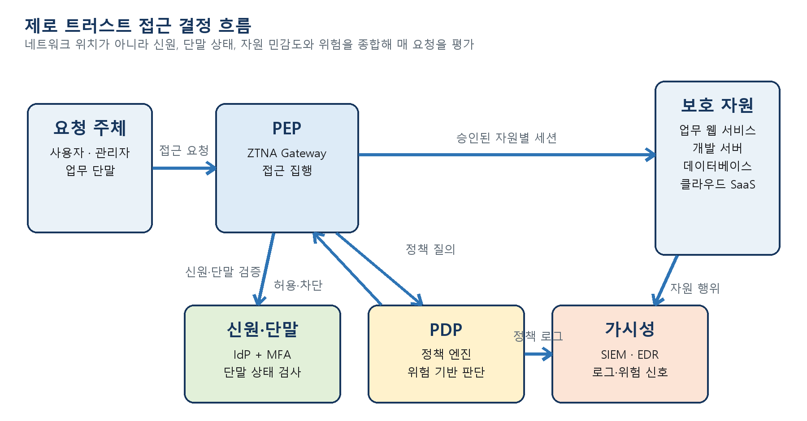
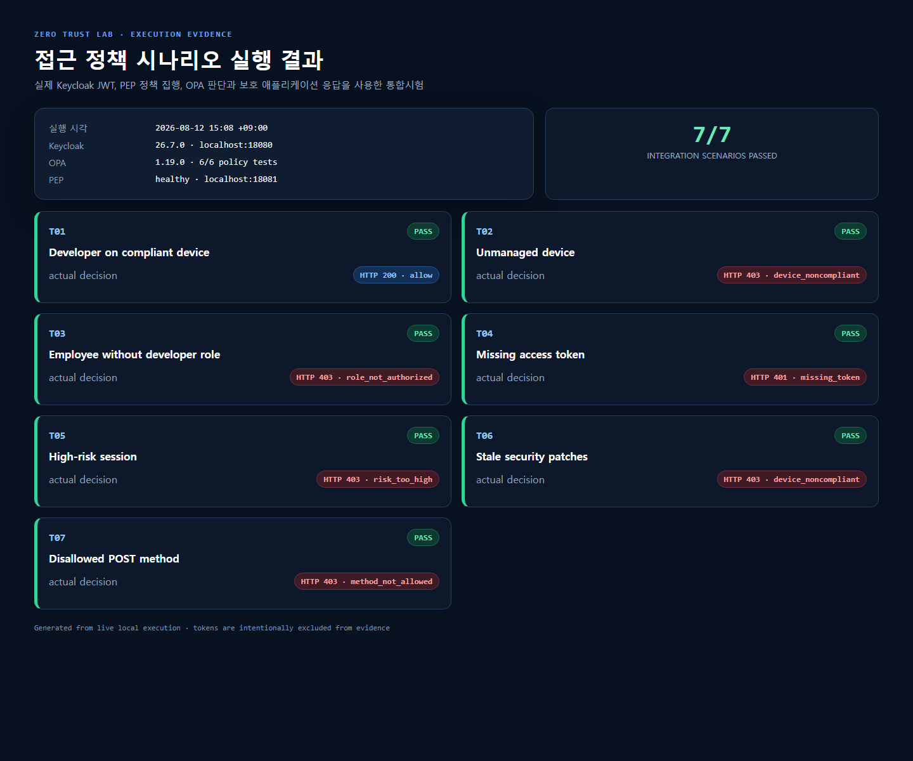

# Zero Trust Network Lab

> Identity-, device-, and risk-aware access control using Keycloak, a custom Policy Enforcement Point (PEP), and Open Policy Agent (OPA).

[](#validation-results)
[](#validation-results)
[](https://github.com/teriyakki-jin/zero-trust-network-lab/actions/workflows/test.yml)
[](compose.yaml)
[](LICENSE)

This project demonstrates a small, reproducible zero-trust access path. Network location alone grants no access: every request requires a verifiable user identity and a policy decision based on role, device posture, risk score, and requested action.

이 프로젝트는 사용자 신원, 단말 상태, 위험 점수 및 요청 행위를 매번 평가하는 제로 트러스트 접근 제어 실습입니다. 단순히 내부 네트워크에 있다는 이유로 보호 자원 접근을 허용하지 않습니다.



## What it demonstrates

- Keycloak-issued, short-lived JWT access tokens
- JWT signature, issuer, audience, and lifetime validation at the PEP
- Policy decision and enforcement separation with OPA
- Default-deny access rules for roles, posture, risk, and HTTP methods
- A protected application with no host-published port
- Separate control-plane and internal data-plane Docker networks
- Structured allow/deny decision logging without exposing access tokens
- Automated OPA unit tests and end-to-end access scenarios

## Architecture

```text
User
  |
  | Bearer JWT + device/risk context
  v
PEP :8081 --------------------> Keycloak/JWKS :8080
  |
  +---------------------------> OPA policy decision
  |
  | only when allowed
  v
Protected application (internal data-plane only)
```

The PEP fails closed when identity verification or policy evaluation is unavailable. It forwards only explicitly selected identity headers and never forwards the bearer token to the protected application.

More detail: [Design and threat model](docs/design.md)

## Quick start

Requirements:

- Docker Desktop or Docker Engine with Compose v2
- PowerShell 5.1 or newer

```powershell
./scripts/start.ps1
./scripts/test-access.ps1
```

On first start, the script creates a gitignored `.env` containing random local passwords. To inspect the generated lab credentials locally:

```powershell
Get-Content .env
```

The `.env` file also controls `KEYCLOAK_HOST_PORT`, `PEP_HOST_PORT`, and the matching `OIDC_ISSUER` when the default host ports are unavailable.

Endpoints:

- Keycloak: `http://localhost:8080`
- PEP health: `http://localhost:8081/healthz`
- Protected application: not exposed directly to the host

Stop the lab:

```powershell
./scripts/stop.ps1
```

To delete the local Keycloak volume and recreate the imported realm, run `docker compose down --volumes`. This removes the lab's persisted identities and settings.

## Policy

The main rule is defined in [`opa/policies/access.rego`](opa/policies/access.rego). A request is allowed only when all conditions are true:

1. A verified Keycloak identity is present.
2. The user has the `developer` or `admin` realm role.
3. The device is managed and reports a healthy EDR state.
4. Security patches are no more than 14 days old.
5. The risk score is below 60.
6. The request uses an allowed HTTP method (`GET` in this lab).
7. The requested resource is the explicitly protected `/project` path.

All other requests are denied by default.

## Validation results

OPA policy unit tests:

```powershell
docker compose run --rm opa test /policies /tests
```

Last verified result: `PASS: 6/6`.

| ID | Scenario | Expected | Verified |
|---|---|---:|---:|
| T01 | Developer on a compliant device | `200 allow` | PASS |
| T02 | Unmanaged device | `403 device_noncompliant` | PASS |
| T03 | Employee without the developer role | `403 role_not_authorized` | PASS |
| T04 | Missing access token | `401 missing_token` | PASS |
| T05 | High-risk session | `403 risk_too_high` | PASS |
| T06 | Stale security patches | `403 device_noncompliant` | PASS |
| T07 | Disallowed POST method | `403 method_not_allowed` | PASS |



Representative evidence:

- [Allowed: compliant developer](docs/evidence/allow-compliant-device.png)
- [Denied: unmanaged device](docs/evidence/deny-unmanaged-device.png)
- [Denied: high-risk session](docs/evidence/deny-high-risk.png)

## Repository map

```text
keycloak/       imported realm, users, roles, and OIDC client
opa/policies/   Rego policy and policy unit tests
pep/            FastAPI policy enforcement point and protected demo app
scripts/        start, stop, and integration-test automation
docs/           architecture, threat model, and representative evidence
.github/        CI and dependency update configuration
```

## Security boundaries and limitations

This is a local educational lab, not a production deployment.

- Device posture is simulated using HTTP headers. A real PEP must obtain posture from a trusted MDM/EDR, device certificate, or attestation service; user-supplied posture headers must never be trusted.
- Resource Owner Password Credentials are used only to automate local integration tests. Production clients should use Authorization Code with PKCE and phishing-resistant MFA.
- Keycloak runs in development mode over loopback HTTP.
- Production deployments require TLS, service/workload identity, protected secrets, highly available policy and identity services, log integrity, rate limiting, and privacy controls.
- The sample application supports only a narrow method set and is intentionally small; it is not a general-purpose reverse proxy.

See [SECURITY.md](SECURITY.md) before reusing any component.

## Standards mapping

The design is informed by:

- [NIST SP 800-207: Zero Trust Architecture](https://doi.org/10.6028/NIST.SP.800-207)
- [NIST SP 1800-35: Implementing a Zero Trust Architecture](https://doi.org/10.6028/NIST.SP.1800-35)
- [CISA Zero Trust Maturity Model 2.0](https://www.cisa.gov/resources-tools/resources/zero-trust-maturity-model)

## License

[MIT](LICENSE)
